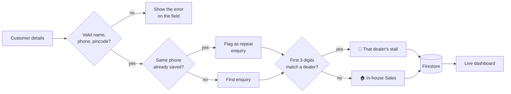

<p align="center">
  
</p>

<p align="center">
  <a href="https://lrdlr-demo.web.app"></a>
</p>

<p align="center">
  
  
  
  
  
  
</p>

<p align="center">
  Routes every customer lead to the dealer who covers its pincode,<br />
  and cleans a messy legacy CSV into the same live database.
</p>

<p align="center">
  <a href="#-what-it-does">What it does</a> ·
  <a href="#-how-a-lead-flows">How a lead flows</a> ·
  <a href="#-ai-features">AI features</a> ·
  <a href="#-importing-a-csv-in-the-browser">Import CSV</a> ·
  <a href="#-run-it-yourself">Run it</a> ·
  <a href="#-cleaning-the-legacy-csv">Data cleanup</a> ·
  <a href="#-docs--tests">Docs & tests</a> ·
  <a href="#-security">Security</a>
</p>

---

> [!NOTE]
> **Everything here is fictional.** Dealers are named after vegetables 🥕, customers after fruits 🍎, and phone numbers follow an obvious `90000 1xxxx` pattern. Cities and pincode prefixes are real geography so the routing rule has realistic input.

## 🥬 What it does

| | Part | What it does |
|---|---|---|
| 📝 | **New lead** (`index.html`) | Validates name, mobile, pincode, product and source. As you type the pincode, the matching **dealer stall lights up** before you save. A number that already exists is saved again and flagged as a repeat enquiry, never blocked. |
| 📤 | **Import CSV** (`import.html`) | Upload a CSV of many leads. Every row is checked with the same rules as the form and shown in a preview — ready, fixed, repeat or rejected, each with its reason. Nothing is saved until you confirm, and imported leads always start as **New**. |
| 📊 | **Dashboard** (`dashboard.html`) | Live counts by status, a bar per dealer, filters, repeat badges, and a colour-coded status picker (New → Contacted → Converted / Lost). Updates in real time across open tabs. |
| 🧹 | **Cleanup + import** (`scripts/clean-and-import.js`) | Reads 40 legacy rows, fixes what is safe to fix, rejects what isn't, writes one line per decision to `reports/reconciliation.csv`, then imports dealers and leads into Firestore. |

## ✨ AI features

Three small AI helpers, all running on a separate Flask server (`ai-server/`, hosted on Render) that holds the Groq key. **The AI only suggests — a person always confirms**, and every value it returns is checked again in Python, in the browser and by the Firestore rules.

| | Feature | Where | What it does |
|---|---|---|---|
| ✨ | **Smart paste** | New lead | Paste a messy WhatsApp-style message (English, Telugu, Hindi or Kannada in English letters). The AI fills name, phone, pincode, product and source; anything it isn't sure of stays empty. Filled boxes turn yellow until you edit them, and you still press **Save**. |
| 📊 | **AI briefing** | Dashboard | A 3–4 sentence summary and one next step. Only **counts** are sent — never names or phone numbers. Rankings are calculated in code, not by the AI. |
| 🔧 | **Import fix** | Import CSV | For rows rejected for an unknown product or source, **Ask AI** maps a typo to one of our own values (`home batery 5` → *Home Battery 5kWh*). It returns nothing for things we don't sell or can't tell apart, and a person clicks **Use it**. |

**Things testing caught and fixed**
- A second Smart paste could mix two customers' details → untouched AI values are cleared before each new fill.
- The briefing suggested moving leads to dealers in other cities → the business rules (dealers serve fixed areas) are now in the prompt.
- The briefing called the 2nd-busiest dealer "the highest" → dealers are ranked in code before the AI sees them.

**AI server safety:** key only in environment variables · CORS limited to the app's own sites · 20 requests/min per IP · 1000-character input limit · prompts treat user text as data, not instructions.

## 🧭 How a lead flows



| Pincode | Prefix | Goes to |
|---|---|---|
| 560034 | 560 | 🍅 Tomato Power Hub |
| 571130 | 571 | 🍆 Brinjal Energy |
| 575001 | 575 | 🥕 Carrot Cell Traders |
| 400001 | 400 | 🏠 No dealer covers it → In-house Sales |

> [!TIP]
> The live preview on the form calls the **same** `assignDealer()` function the save uses, so what you see before saving can never disagree with where the lead actually goes.

## 📤 Importing a CSV in the browser

Try it with [`public/sample-leads.csv`](public/sample-leads.csv) (also downloadable from the Import page). It has 13 rows built to hit every case:

| Result | Rows | Example |
|---|---|---|
| 🟢 Ready | 6 | 🍓 Raspberry R → 🍅 Tomato Power Hub |
| 🟡 Fixed | 1 | `+91 90000 20002`, `home battery 5 kwh`, `whatsapp` cleaned up |
| 🔵 Repeat | 2 | 🍎 Apple A already exists; 🍓 Raspberry R appears twice in the file |
| 🔴 Rejected | 4 | bad phone, 4-digit pincode, unknown product, missing name |

- **Why status is always New:** the page is public, so trusting a status column would let anyone upload fake "Converted" sales.
- **Batch writes:** good rows are saved with `writeBatch` (up to 400 per batch, all-or-nothing). If a batch fails, *Try again* continues from where it stopped and never writes a row twice.
- Unlike the one-off Node script, the browser can only save products and sources the security rules allow, so an unknown product is rejected here rather than imported for review.

## 📘 Docs & tests

- [User guide](docs/USER_GUIDE.md) — one page for the people using the app
- [Troubleshooting](docs/TROUBLESHOOTING.md) — what each error means and how to fix it
- `npm test` — 7 checks on the phone, pincode, product and dealer rules (Node's built-in runner, no installs)
- `cd ai-server && python -m unittest -v` — 10 checks on the AI server with a fake Groq: bad AI values are dropped, only our own products are suggested, other websites are blocked, rate limit works

## 🚀 Run it yourself

1. Install Node.js 18+, then:
   ```bash
   npm install
   ```
2. Put your web app config in `public/firebase-init.js` (Firebase console → Project settings → Your apps) and your project ID in `.firebaserc`.
3. Try the cleanup without touching any database:
   ```bash
   npm run dry-run
   ```
4. Import for real: Project settings → Service accounts → **Generate new private key**, save it as `service-account-key.json` in the project root, then:
   ```bash
   npm run clean-and-import
   ```
5. Run locally and deploy:
   ```bash
   npm run serve
   npx firebase-tools deploy --only hosting,firestore:rules
   ```
6. AI server (optional — the app works without it):
   ```bash
   cd ai-server
   cp .env.example .env        # then put your real GROQ_API_KEY in .env
   pip install -r requirements.txt
   python app.py               # http://127.0.0.1:5000/health
   ```
   On Render: root directory `ai-server`, build `pip install -r requirements.txt`, start `gunicorn app:app`, and set `GROQ_API_KEY` in Environment. Put the Render URL in `public/ai-config.js`.

> [!IMPORTANT]
> `service-account-key.json` is a password for your whole database. It is git-ignored — never commit it, and revoke it in the Google Cloud console when you are done.

Re-running the import is safe: leads already in Firestore are left untouched, so a status changed on the dashboard is never reset.

## 🧹 Cleaning the legacy CSV

Every problem below is planted in `data/legacy_leads.csv` on purpose.

| Problem | Example | What happens |
|---|---|---|
| Messy phone formats | `90000 10 004`, `+91-9000010006` | 🟡 Fixed to 10 digits |
| Invalid phone | `12345` | 🔴 Rejected |
| 4-digit pincode | `5600` | 🔴 Rejected — guessing digits could send the lead to the wrong dealer |
| Missing name | blank | 🔴 Rejected |
| Impossible date | `31/09/2026` | 🟡 Fixed to `2026-09-30`, and the change is logged |
| Casing and spaces | `converted `, `website` | 🟡 Fixed to `Converted`, `Website` |
| No dealer for pincode | `400001` | 🟣 Routed to In-house Sales |
| Same phone again | 🍒 Cherry C twice | 🔵 Kept as its own lead, flagged with `repeat_of` |
| Reused lead ID | `L1033` used twice | 🔵 Second one saved as `L1033-DUP`, flagged as a repeat |

| Result | Rows |
|---|---|
| 🟢 Imported as-is | 26 |
| 🟡 Fixed | 5 |
| 🟣 In-house | 1 |
| 🔵 Repeat enquiry | 5 |
| 🔴 Rejected | 3 |

**37 kept, 3 rejected.**

> [!WARNING]
> **One row is left for a human.** 🍉 Watermelon W has the product `home battery 5 kwh`. It is probably *Home Battery 5kWh*, but the script fixes formatting — it does not guess intent. The row is imported exactly as written so someone can review it.

## 🔐 Security

- **Dealers** are read-only from the browser. Only the import script (Admin SDK) writes them.
- **Leads** can be created only with exactly the fields the form sends (`hasOnly`), a valid phone, pincode, product and source, status `New`, and the server's own timestamp. Only `status` can be changed afterwards, and nothing can be deleted.
- **Dashboard text is HTML-escaped**, so a name like `` submitted through the public form shows up as text and never runs.
- There is no login in this demo. A real deployment would put the dashboard behind Firebase Auth.

## 🗂️ Project layout

```
public/                  The web app (deployed to Firebase Hosting)
  index.html             New lead form + dealer stalls
  import.html            Import CSV page
  import.js              Parse, check, preview and batch-import a CSV
  sample-leads.csv       Test file for the Import page
  dashboard.html         Live dashboard
  app.js                 Validation, live routing preview, save
  dashboard.js           Live list, stats, status updates
  dealer-assign.js       The pincode → dealer rule
  validate.js            Phone, pincode and name checks
  produce.js             Fruit and vegetable emoji for the demo names
  ai-config.js           Where the AI server lives (local or Render)
  sample-typos.csv       Test file for the Import AI fix
  firebase-init.js       Firebase web config (not secret)
  style.css              Fresh-market theme
scripts/
  clean-and-import.js    Cleans and imports the legacy CSV
ai-server/               Flask API for the AI features (deployed to Render)
  app.py                 /health, /extract, /summary, /suggest
  requirements.txt
  .env.example           Copy to .env locally; never commit .env
data/
  dealers.csv            6 vegetable dealers
  legacy_leads.csv       40 fruit customers, with planted data problems
firestore.rules          Security rules
banner.svg               The animated banner above
```
