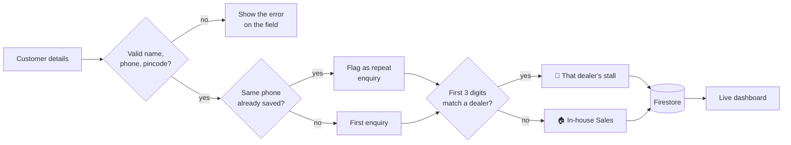

<p align="center">
  
</p>

<p align="center">
  <a href="https://lrdlr-demo.web.app"></a>
</p>

<p align="center">
  
  
  
  
</p>

<p align="center">
  Routes every customer lead to the dealer who covers its pincode,<br />
  and cleans a messy legacy CSV into the same live database.
</p>

<p align="center">
  <a href="#-what-it-does">What it does</a> ·
  <a href="#-how-a-lead-flows">How a lead flows</a> ·
  <a href="#-run-it-yourself">Run it</a> ·
  <a href="#-cleaning-the-legacy-csv">Data cleanup</a> ·
  <a href="#-security">Security</a>
</p>

---

> [!NOTE]
> **Everything here is fictional.** Dealers are named after vegetables 🥕, customers after fruits 🍎, and phone numbers follow an obvious `90000 1xxxx` pattern. Cities and pincode prefixes are real geography so the routing rule has realistic input.

## 🥬 What it does

| | Part | What it does |
|---|---|---|
| 📝 | **New lead** (`index.html`) | Validates name, mobile, pincode, product and source. As you type the pincode, the matching **dealer stall lights up** before you save. A number that already exists is saved again and flagged as a repeat enquiry, never blocked. |
| 📊 | **Dashboard** (`dashboard.html`) | Live counts by status, a bar per dealer, filters, repeat badges, and a colour-coded status picker (New → Contacted → Converted / Lost). Updates in real time across open tabs. |
| 🧹 | **Cleanup + import** (`scripts/clean-and-import.js`) | Reads 40 legacy rows, fixes what is safe to fix, rejects what isn't, writes one line per decision to `reports/reconciliation.csv`, then imports dealers and leads into Firestore. |

## 🧭 How a lead flows



| Pincode | Prefix | Goes to |
|---|---|---|
| 560034 | 560 | 🍅 Tomato Power Hub |
| 571130 | 571 | 🍆 Brinjal Energy |
| 575001 | 575 | 🥕 Carrot Cell Traders |
| 400001 | 400 | 🏠 No dealer covers it → In-house Sales |

> [!TIP]
> The live preview on the form calls the **same** `assignDealer()` function the save uses, so what you see before saving can never disagree with where the lead actually goes.

## 🚀 Run it yourself

1. Install Node.js 18+, then:
   ```bash
   npm install
   ```
2. Put your web app config in `public/firebase-init.js` (Firebase console → Project settings → Your apps) and your project ID in `.firebaserc`.
3. Try the cleanup without touching any database:
   ```bash
   npm run dry-run
   ```
4. Import for real: Project settings → Service accounts → **Generate new private key**, save it as `service-account-key.json` in the project root, then:
   ```bash
   npm run clean-and-import
   ```
5. Run locally and deploy:
   ```bash
   npm run serve
   npx firebase-tools deploy --only hosting,firestore:rules
   ```

> [!IMPORTANT]
> `service-account-key.json` is a password for your whole database. It is git-ignored — never commit it, and revoke it in the Google Cloud console when you are done.

Re-running the import is safe: leads already in Firestore are left untouched, so a status changed on the dashboard is never reset.

## 🧹 Cleaning the legacy CSV

Every problem below is planted in `data/legacy_leads.csv` on purpose.

| Problem | Example | What happens |
|---|---|---|
| Messy phone formats | `90000 10 004`, `+91-9000010006` | 🟡 Fixed to 10 digits |
| Invalid phone | `12345` | 🔴 Rejected |
| 4-digit pincode | `5600` | 🔴 Rejected — guessing digits could send the lead to the wrong dealer |
| Missing name | blank | 🔴 Rejected |
| Impossible date | `31/09/2026` | 🟡 Fixed to `2026-09-30`, and the change is logged |
| Casing and spaces | `converted `, `website` | 🟡 Fixed to `Converted`, `Website` |
| No dealer for pincode | `400001` | 🟣 Routed to In-house Sales |
| Same phone again | 🍒 Cherry C twice | 🔵 Kept as its own lead, flagged with `repeat_of` |
| Reused lead ID | `L1033` used twice | 🔵 Second one saved as `L1033-DUP`, flagged as a repeat |

| Result | Rows |
|---|---|
| 🟢 Imported as-is | 26 |
| 🟡 Fixed | 5 |
| 🟣 In-house | 1 |
| 🔵 Repeat enquiry | 5 |
| 🔴 Rejected | 3 |

**37 kept, 3 rejected.**

> [!WARNING]
> **One row is left for a human.** 🍉 Watermelon W has the product `home battery 5 kwh`. It is probably *Home Battery 5kWh*, but the script fixes formatting — it does not guess intent. The row is imported exactly as written so someone can review it.

## 🔐 Security

- **Dealers** are read-only from the browser. Only the import script (Admin SDK) writes them.
- **Leads** can be created only with exactly the fields the form sends (`hasOnly`), a valid phone, pincode, product and source, status `New`, and the server's own timestamp. Only `status` can be changed afterwards, and nothing can be deleted.
- **Dashboard text is HTML-escaped**, so a name like `` submitted through the public form shows up as text and never runs.
- There is no login in this demo. A real deployment would put the dashboard behind Firebase Auth.

## 🗂️ Project layout

```
public/                  The web app (deployed to Firebase Hosting)
  index.html             New lead form + dealer stalls
  dashboard.html         Live dashboard
  app.js                 Validation, live routing preview, save
  dashboard.js           Live list, stats, status updates
  dealer-assign.js       The pincode → dealer rule
  validate.js            Phone, pincode and name checks
  produce.js             Fruit and vegetable emoji for the demo names
  firebase-init.js       Firebase web config (not secret)
  style.css              Fresh-market theme
scripts/
  clean-and-import.js    Cleans and imports the legacy CSV
data/
  dealers.csv            6 vegetable dealers
  legacy_leads.csv       40 fruit customers, with planted data problems
firestore.rules          Security rules
banner.svg               The animated banner above
```

- `dealers`: read-only from the browser.
- `leads`: create only with exactly the fields the form sends (`hasOnly`), valid phone/pincode/product/source, status `New` and server time; only `status` can be updated; no deletes.
- The dashboard text is HTML-escaped, so a malicious name submitted through the public form is shown as text and never runs.
- No login in this demo — a real deployment would put the dashboard behind Firebase Auth.
